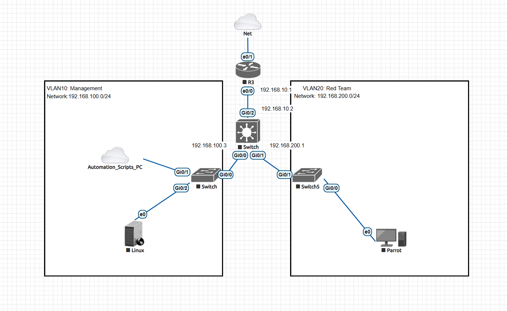

# NOC Security Toolkit

**The goal of this project is to provide the most important tools for any network security environment.**

Every network, from a small office to a large enterprise, needs the same core capabilities: know what is configured on each device, make sure it is configured securely, notice when something changes, and get alerted when something goes wrong. This repository builds those capabilities as small, practical tools that work together, and tests them in a realistic lab.



## Why this project

Most network security failures are not exotic attacks. They are missing backups, forgotten Telnet access, default SNMP communities, switches without Layer 2 protections, and changes nobody noticed. Commercial platforms solve this but are expensive and heavy. This toolkit shows how far a few focused, open scripts can go.

## Tools

| Tool | What it does | Status |
|---|---|---|
| [Config Backup Tool](src/Config_Backup_Tool/) | Automatically backs up device configurations over SSH, keeps per-device history with retention, optionally encrypts backups, and reports results to Telegram and Zabbix | Done |
| [Config Auditor](src/Auditor_Tool/) | Audits the backed-up configs against 19 hardening rules (management plane, credentials, services, Layer 2) and writes JSON and Markdown reports | Done |
| Change detection | Compares consecutive backups and alerts on unexpected configuration changes | Planned |
| Port scanner | Verifies which services are exposed and validates firewall rules | Planned |
| Log analyzer | Detects suspicious patterns such as brute-force attempts and maps them to MITRE ATT&CK | Planned |
| IOC checker | Enriches IPs and file hashes with threat intelligence | Planned |

## How the tools fit together

```
 Network devices
       |  SSH (Netmiko)
       v
 Config Backup Tool --> per-device backup folders --> Config Auditor --> JSON / Markdown reports
       |
       +--> Telegram alerts
       +--> Zabbix (trapper items and triggers)
```

- The backup tool is the foundation: everything else works on the configurations it collects.
- The auditor reads the newest backup of every device, so no extra connection to the devices is needed.
- Wiring auditor results into the alerting channels, and comparing backups over time, are the next steps.

## Design principles

- **Practical first:** each tool solves one real operational problem and is usable on its own.
- **Automation friendly:** machine-readable output (JSON), clear exit codes, and scheduled runs.
- **Safe by default:** no secrets in code or reports. Tokens live in environment variables, device inventories are kept out of Git, and backups can be encrypted.
- **Simple to run:** Python with few dependencies, and clear documentation for each tool.
- **Tested in a lab:** every tool is run against a real EVE-NG topology and documented with evidence.

## Lab environment

The tools are developed and tested in an EVE-NG lab that includes an edge router, a multilayer switch, access switches, a management VLAN, a "Red Team" VLAN, an automation host, and a Zabbix server. See the [topology diagram](docs/topology.png) and the screenshots under [`docs/`](docs/) and [`evidence/`](evidence/).

## Repository layout

```
noc-security/
├── src/
│   ├── Config_Backup_Tool/   # backup, encryption, Telegram and Zabbix alerts
│   └── Auditor_Tool/         # configuration security auditor
│   └── Zabbix_Alerts/        # configuraton alerts
├── docs/                     # topology and tool documentation / screenshots
├── evidence/                 # proof of runs in the lab
└── reports/                  # sample audit reports
```

## Getting started

```powershell
git clone https://github.com/AzizAshraf25/noc-security.git
cd noc-security
```

Then follow the README of the tool you want to use:

1. [Config Backup Tool](src/Config_Backup_Tool/): set up the device inventory and run your first backup.
2. [Config Auditor](src/Auditor_Tool/): audit the backups and review the report.
3. [Alerts](src/Zabbix_Alerts/): alerts (Zabbix & Telegram) for each backup.

Requirements: Python 3 and access to your network devices over SSH. Each tool lists its own dependencies.

## Security notes

- Use these tools only on devices you own or are explicitly authorized to manage and assess.
- Never commit credentials, API tokens, encryption keys, or real device inventories. Use environment variables and example files instead.
- Reports are designed not to copy secrets from configs, but review them before sharing.

## Roadmap

- [x] Automated configuration backup with retention
- [x] Telegram and Zabbix notifications for backup results
- [x] Configuration security auditor
- [x] Send auditor findings to Telegram and Zabbix
- [x] Change detection between backups
- [ ] Port scanner for service exposure checks
- [ ] Log analyzer and IOC checker for SOC use cases

## Author

Built by Aziz ([@AzizAshraf25](https://github.com/AzizAshraf25)) as a hands-on project for network operations and network security.
