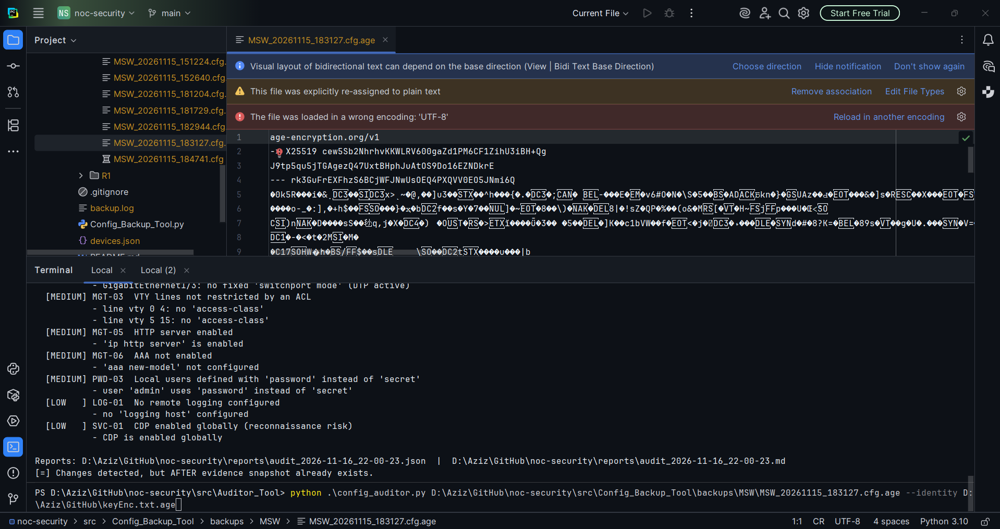
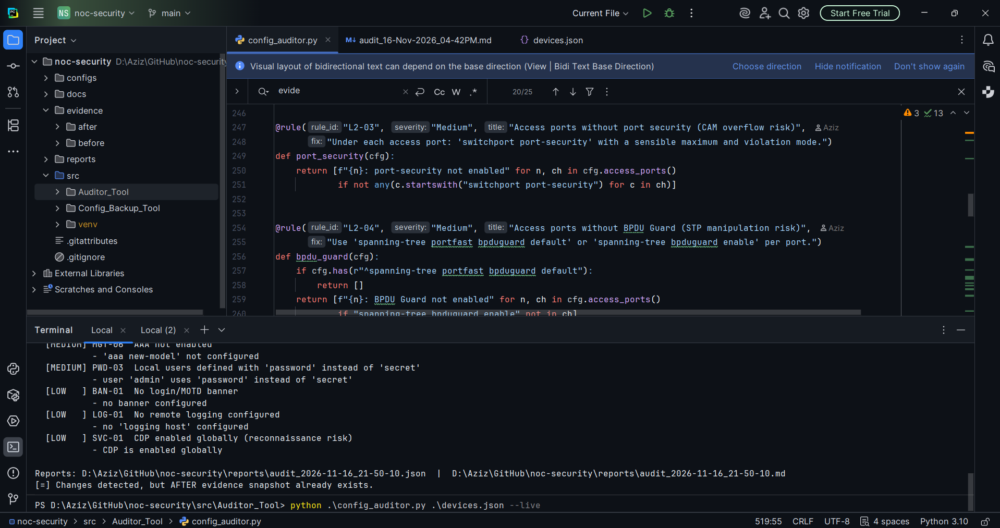
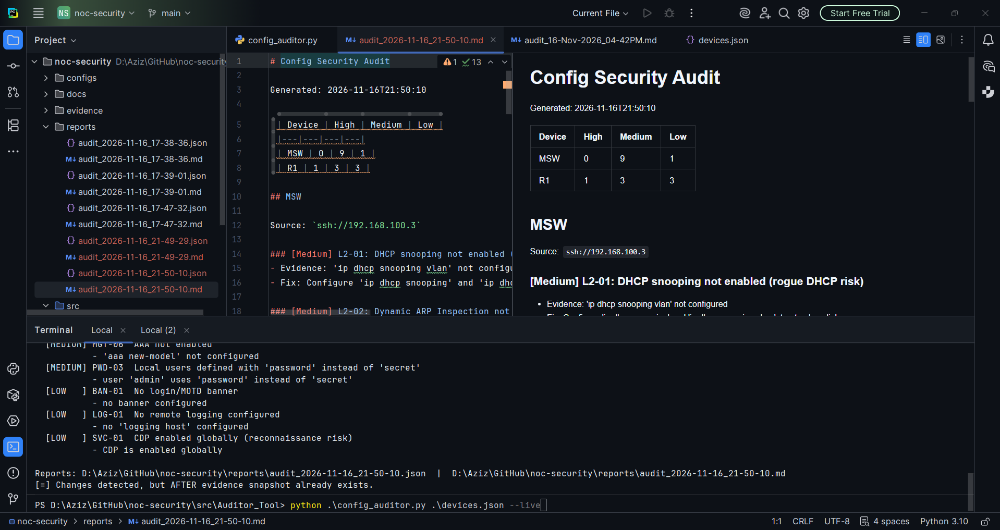
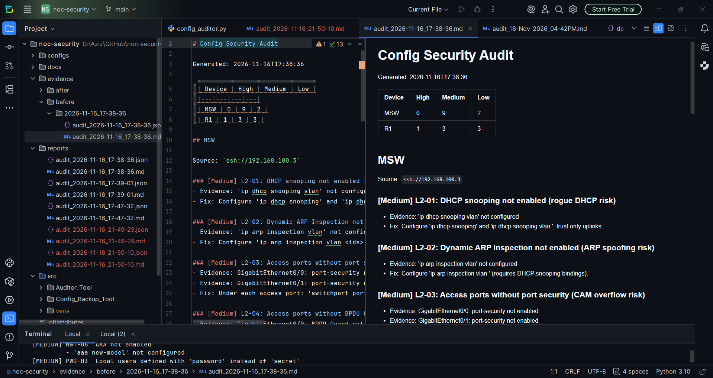
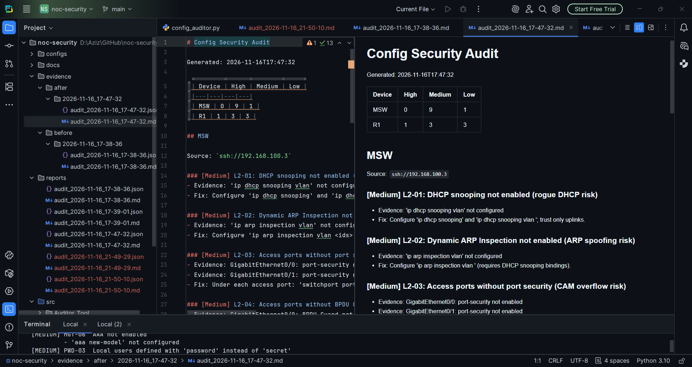

# Config Auditor Tool

A Python tool that audits backed-up Cisco IOS configurations against security hardening rules and produces JSON and Markdown reports.
It is Phase 2 of my NOC Security Automation project, built and tested in an EVE-NG lab.

```
Config Backup  ->  Config Auditor  ->  Alerts (Telegram / Zabbix)  ->  Change detection
  (Phase 1)         (this tool)            (Phase 3)                     (Phase 4)
```

> Audit only devices you own or are authorized to assess. Everything here was run in my own lab.

## Lab environment

- EVE-NG lab with router R3, the MSW multilayer switch (192.168.100.3), an access switch, and two VLANs: VLAN10 Management (192.168.100.0/29) and VLAN20 Red Team (192.168.100.8/30). See [the topology](../../docs/Topology.png).
- Configs are pulled by my Config Backup Tool (Netmiko), which saves each device in its own folder and runs daily through Windows Task Scheduler.
- The auditor reads those backups, so no extra connection to the devices is needed.

## Features

- Audits the **newest backup of every device** automatically (one subfolder per device).
- 19 hardening rules across the management plane, credentials, services and Layer 2.
- Findings sorted by severity (High, Medium, Low) with evidence and a recommended fix.
- JSON output for automation and a Markdown report for people.
- Secrets are never copied into reports: passwords are not printed and non-default SNMP community strings show as `<hidden>`.
- `--fail-on` option returns exit code 1 when findings reach a given severity, so it can be used in scheduled jobs.

## Quick start

```powershell
# audit every device in the backup folder (newest file per device)
python config_auditor.py "<path to backups folder>"

# audit a single config file
python config_auditor.py .\samples\WEAK-SW\WEAK-SW_sample.cfg

# write reports to a custom folder and fail on High findings
python config_auditor.py "<path to backups folder>" --out-dir reports --fail-on High
```

Requirements: Python 3.8+ and no external libraries (standard library only).
Backups must be plain text; encrypted backups are skipped with a warning.

## How it works

1. Picks the newest config file in each device folder.
2. Parses the config into top-level lines and indented blocks (interfaces, `line vty`, ...).
3. Runs each rule, a small function that returns evidence strings (empty list = pass).
4. Sorts the findings and writes `reports/audit_<timestamp>.json` and `.md`.

Adding a new rule means writing one function with the `@rule(...)` decorator.

## Rules

| ID | Severity | Check | Risk it addresses |
|---|---|---|---|
| MGT-01 | High | Telnet allowed on VTY | Clear-text management |
| MGT-02 | Medium | SSH v2 not enforced | Weak remote access |
| MGT-03 | Medium | No ACL on VTY | Management exposure |
| MGT-04 | Medium | `exec-timeout 0 0` | Unattended sessions |
| MGT-05 | Medium | HTTP server enabled | Unneeded service |
| MGT-06 | Medium | AAA not enabled | No centralized auth |
| PWD-01 | High | No `enable secret` / `enable password` present | Weak privileged access |
| PWD-02 | Low | No `service password-encryption` | Readable passwords |
| PWD-03 | Medium | Users with `password` instead of `secret` | Weak credential storage |
| SNMP-01 | High | `public`/`private` or RW communities | Info leak, device takeover |
| SVC-01 | Low | CDP enabled globally | CDP reconnaissance |
| LOG-01 | Low | No remote syslog | No central visibility |
| BAN-01 | Low | No banner | Missing legal warning |
| L2-01 | Medium | No DHCP snooping | Rogue DHCP |
| L2-02 | Medium | No Dynamic ARP Inspection | ARP spoofing |
| L2-03 | Medium | Access ports without port security | CAM table overflow |
| L2-04 | Medium | Access ports without BPDU Guard | STP manipulation |
| L2-05 | Medium | Ports in dynamic (DTP) mode | VLAN hopping |
| L2-06 | Medium | Trunks on native VLAN 1 | VLAN hopping |

Layer 2 rules run only on devices that look like switches. Shutdown and routed (`no switchport`) ports are skipped.

## Demo and evidence

**1. Backups collected.** The Config Backup Tool saved the running-config of each device in its own folder.



**2. Live audit before hardening.** The auditor run against the latest backups, with findings sorted by severity.



**3. Markdown report.** The generated report lists each finding with its evidence and fix.



**4. Hardening applied.** Fixes applied on the device based on the findings.



**5. Audit after hardening.** A new backup and a new audit run, showing the findings that were closed.



## Results

| | Before | After |
|---|-------|-------|
| High | 1     | 1     |
| Medium | 12    | 12    |
| Low | 5     | 4     |

Findings fixed: (fill in rule IDs, e.g. MGT-01, MGT-02, L2-03)

## Limitations

- Text and regex based: it checks what is written in the config, not the live device state.
- IOS and IOS-XE syntax only.
- It verifies that controls exist, not that passwords are strong or ACLs are correct.
- Some checks (for example DHCP snooping and DAI) depend on the lab design and may need tuning for other networks.

## Roadmap

- [x] Phase 1: Config Backup to per-device folders with daily scheduling
- [x] Phase 2: Config Auditor (this tool)
- [ ] Phase 3: Send High findings to Telegram and Zabbix
- [ ] Phase 4: Detect configuration changes between backups
