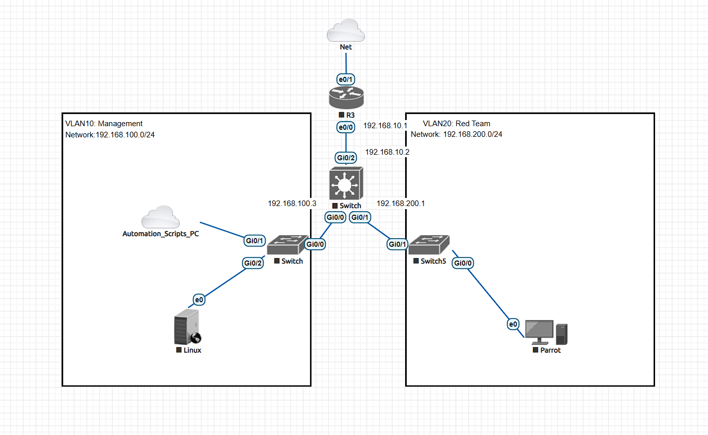
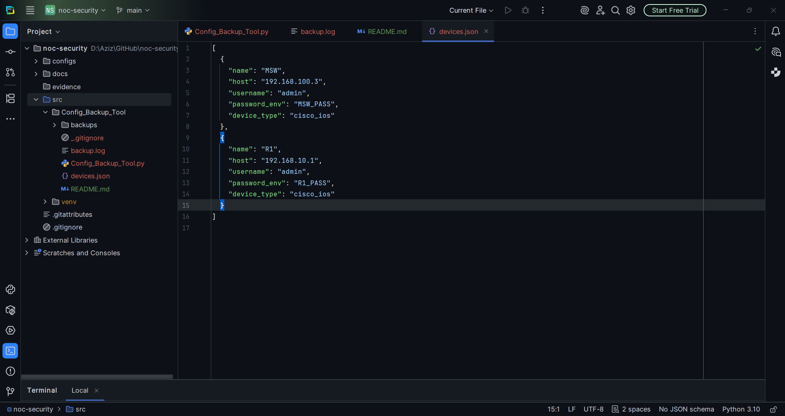
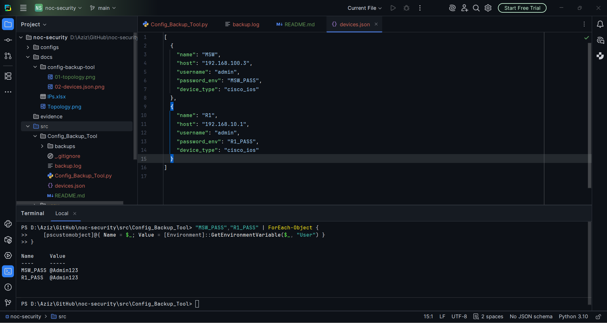
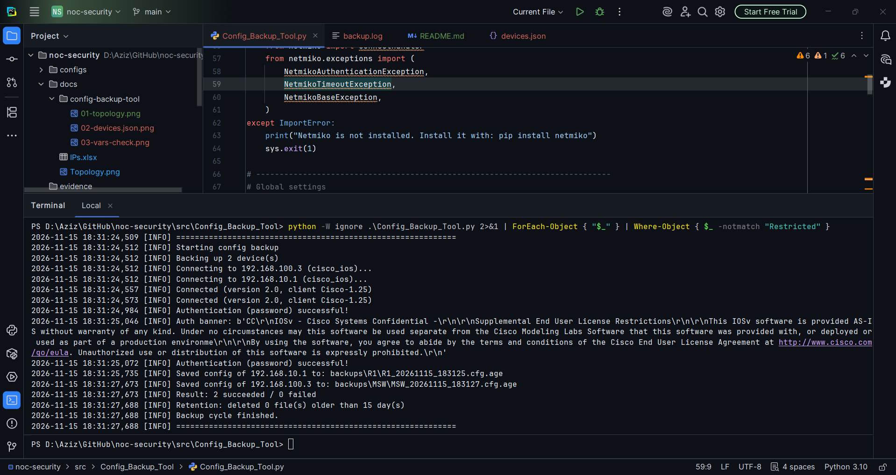
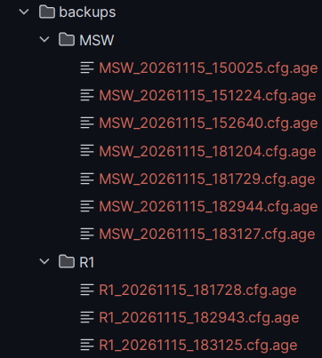
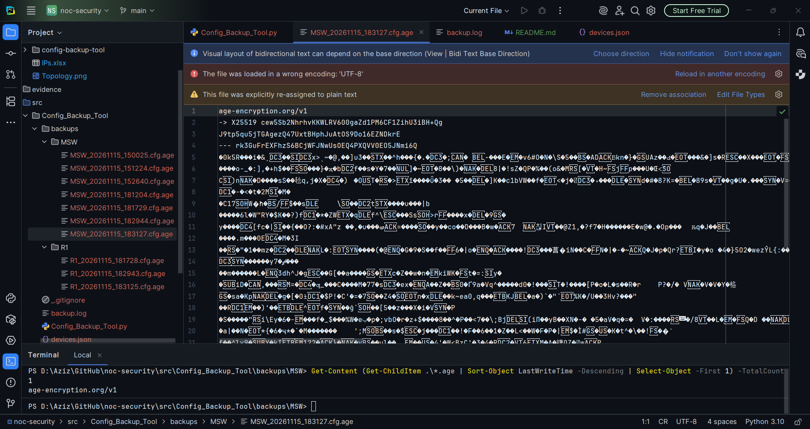
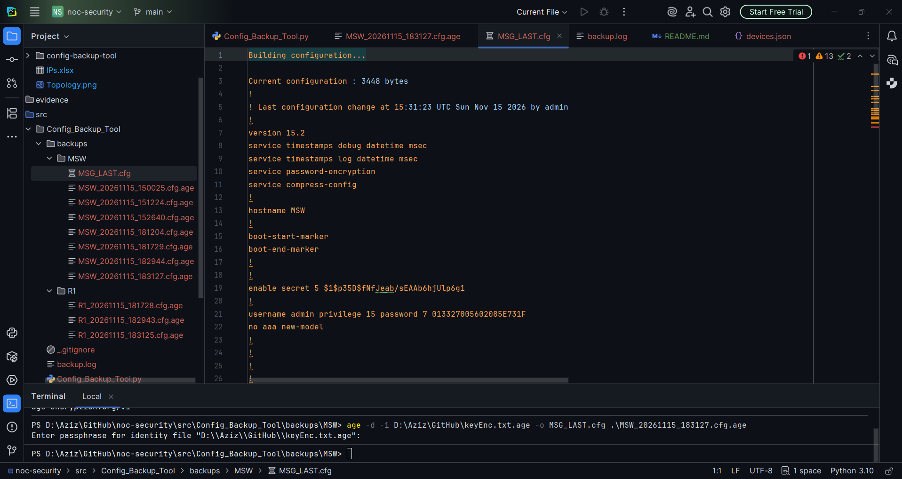
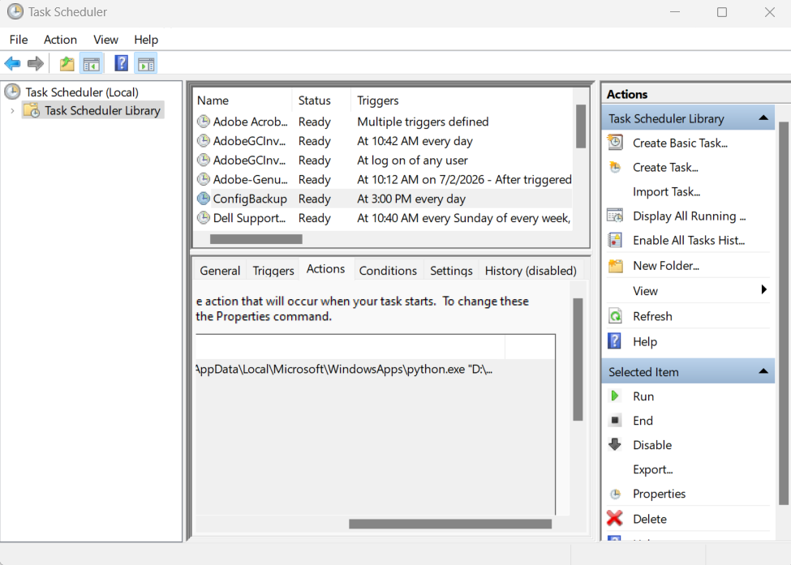
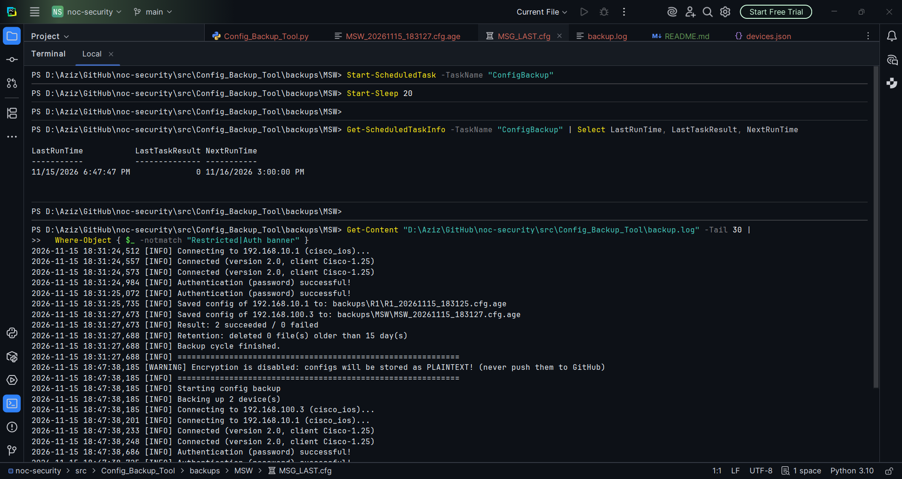

# Config Backup Tool

Automated, encrypted configuration backups for network devices, built with Python and [Netmiko](https://github.com/ktbyers/netmiko) and tested on an EVE-NG lab.

The tool reads a device inventory, connects to every device in parallel over SSH, pulls the running configuration, **encrypts it with [age](https://github.com/FiloSottile/age) before it touches the disk**, stores it in a per-device folder, and removes backups older than a retention period. It can run on a schedule (Windows Task Scheduler, cron, or the built-in scheduler).

> The lab network is fully virtual (EVE-NG, private RFC 1918 addressing). No real infrastructure or credentials appear in this repository.

---

## Features

- **Parallel backups** of multiple devices (`--workers`, default 5)
- **One folder per device**: `backups/<device>/<device>_<YYYYMMDD_HHMMSS>.cfg.age`
- **Public-key encryption with age**: the config is piped to `age` through stdin, so a plaintext copy is never written to disk. The private key is kept offline
- **Retention policy**: deletes backups older than N days (default 15) but **always keeps the newest backup of each device**
- **No hard-coded secrets**: passwords and enable secrets are read from environment variables (`password_env`, `secret_env`); SSH keys are supported (`key_file`)
- **Hardened output folder**: `icacls` ACL on Windows, `chmod 700/600` on Linux
- **Scheduling**: built-in `--schedule HH:MM`, or run it from Task Scheduler / cron
- **Optional Git commit & push** of the backup folder (`--push`)
- **Multi-vendor**: `cisco_ios`, `cisco_xe`, `cisco_nxos`, `cisco_asa`, `juniper_junos`, `arista_eos`, `huawei`, `fortinet`
- **Clear logging** to console and a rotating `backup.log`, with a per-run success/failure summary

---

## Lab topology



| Segment | Network | Addressing |
|---|---|---|
| VLAN 10 - Management | `192.168.100.0/24` | Static |
| VLAN 20 - Red Team | `192.168.200.0/24` | DHCP |
| Router <-> Multilayer switch | `192.168.10.0/30` | Static |

The automation host reaches the multilayer switch (`MSW`, `192.168.100.3`) through the management VLAN.

---

## Requirements

- Python 3.10+
- `pip install netmiko`
- [`age`](https://github.com/FiloSottile/age) available in `PATH`
  - Windows: `winget install FiloSottile.age`
  - Debian/Ubuntu: `sudo apt install age`
- SSH access to the devices

---

## Setup

### 1. Device inventory

Copy the example file and edit it:

```powershell
Copy-Item devices.example.json devices.json
```



| Field | Required | Description |
|---|---|---|
| `host` | yes | IP or hostname |
| `username` | yes | SSH user |
| `device_type` | no | Netmiko device type (default `cisco_ios`) |
| `name` | no | Folder/file name. If omitted, it is taken from the device prompt |
| `password` | one of these | Plaintext password (avoid; use `password_env`) |
| `password_env` | one of these | **Name** of an environment variable that holds the password |
| `key_file` | one of these | Path to an SSH private key. On Windows use forward slashes, e.g. `C:/Users/me/.ssh/id_ed25519` |
| `secret_env` | no | **Name** of an environment variable holding the enable secret (not needed for privilege-15 users) |

> `password_env` takes the **variable name** (for example `MSW_PASS`), not the password itself.

### 2. Credentials as environment variables

```powershell
setx MSW_PASS "your-device-password"
```

`setx` only affects **new** terminals, so open a new PowerShell window afterwards. To check without printing the secret:

```powershell
if ($env:MSW_PASS) { "MSW_PASS is set" } else { "MSW_PASS is missing" }
```



### 3. Encryption keys (age)

Generate the key pair on a removable drive or an offline machine, not inside this repository:

```powershell
age-keygen -o key.txt                  # prints:  Public key: age1...
age -p -o key.txt.age key.txt          # protect the private key with a passphrase
Remove-Item key.txt                    # delete the plaintext private key
setx AGE_RECIPIENT "age1xxxxxxxxxxxxxxxx"   # only the PUBLIC key lives on the backup host
```

The backup host can **encrypt** but never **decrypt**. Keep `key.txt.age` and its passphrase somewhere safe (at least two copies): without them the backups cannot be recovered.

---

## Usage

```powershell
# Run once
python Config_Backup_Tool.py

# Custom inventory, workers and retention
python Config_Backup_Tool.py --devices devices.json --workers 5 --retention-days 15

# Stay alive and back up every day at 02:00
python Config_Backup_Tool.py --schedule 02:00

# Commit and push the backup folder afterwards (encrypted backups only)
python Config_Backup_Tool.py --push --branch main

# Lab/testing only: store plaintext
python Config_Backup_Tool.py --no-encrypt
```

| Option | Description |
|---|---|
| `--devices PATH` | Path to the inventory file (default: `devices.json` next to the script) |
| `--schedule HH:MM` | Run daily at this time (keeps the process alive) |
| `--retention-days N` | Delete backups older than N days (default 15) |
| `--workers N` | Parallel connections (default 5) |
| `--push` / `--branch` | Git commit and push after the run |
| `--no-encrypt` | Store configs as plaintext (not recommended) |
| `--no-acl` | Windows: do not modify folder ACLs |

### Example run



Backups are stored per device:



### Verify the file is really encrypted

```powershell
Get-Content .\backups\MSW\*.age -TotalCount 1
# age-encryption.org/v1
```



### Restore / read a backup

```powershell
age -d -i key.txt.age -o MSW.cfg .\backups\MSW\MSW_20261115_152640.cfg.age
```

`age` asks for the passphrase of the private key. Delete the decrypted file when you are done.



---

## Scheduling on Windows (Task Scheduler)

```powershell
$python = (Get-Command python).Source
$script = "D:\path\to\Config_Backup_Tool.py"

$action   = New-ScheduledTaskAction -Execute $python `
            -Argument "`"$script`"" -WorkingDirectory (Split-Path $script)
$trigger  = New-ScheduledTaskTrigger -Daily -At "15:00"
$settings = New-ScheduledTaskSettingsSet -StartWhenAvailable `
            -AllowStartIfOnBatteries -DontStopIfGoingOnBatteries `
            -ExecutionTimeLimit (New-TimeSpan -Hours 1)

Register-ScheduledTask -TaskName "ConfigBackup" -Action $action `
    -Trigger $trigger -Settings $settings -Description "Daily network config backup"
```

Test it immediately and check the result:

```powershell
Start-ScheduledTask -TaskName "ConfigBackup"
Get-ScheduledTaskInfo -TaskName "ConfigBackup" | Select LastRunTime, LastTaskResult, NextRunTime
Get-Content .\backup.log -Tail 15
```

`LastTaskResult = 0` means success. The task runs as the same user that set `MSW_PASS` and `AGE_RECIPIENT`, so it sees those variables.




On Linux, use cron instead:

```
0 2 * * * /usr/bin/python3 /opt/config-backup/Config_Backup_Tool.py
```

---

## Security model

| Threat | Mitigation |
|---|---|
| Someone reads the backups | age public-key encryption; the private key is offline and passphrase-protected |
| Plaintext config on disk | Encryption happens in memory via stdin |
| Credentials in code or Git | Passwords come from environment variables; `devices.json`, `backups/`, keys and logs are in `.gitignore` |
| Other local accounts reading the folder | `icacls` / `chmod` restrict the backup directory |
| Stolen laptop or disk | Use full-disk encryption (BitLocker) |

**Known limitation:** the script runs as a normal user. Anyone who is logged in as that same user can still run or edit the script and inventory. For stronger separation, run it under a dedicated service account that owns the folder, and keep the daily user without write access to it.

---

## Troubleshooting

| Symptom | Cause and fix |
|---|---|
| `neither a password nor a key_file is available` | `password_env` must contain the variable **name**, and the variable must exist in the current terminal. Open a new terminal after `setx` |
| `AGE_RECIPIENT is not set` | Run `setx AGE_RECIPIENT "age1..."` and open a new terminal |
| `'age' was not found in PATH` | Install age and reopen the terminal |
| `key_file does not exist` | Use a real path for your OS (forward slashes on Windows) |
| `Unable to negotiate ... no matching key exchange method` (manual `ssh`) | Old IOS offers only legacy algorithms. Add to `~/.ssh/config`: `KexAlgorithms +diffie-hellman-group14-sha1`, `HostKeyAlgorithms +ssh-rsa`, `MACs +hmac-sha1`. Netmiko (paramiko) negotiates these on its own |
| `CryptographyDeprecationWarning: TripleDES` | Harmless warning from paramiko. Hide it with `python -W ignore Config_Backup_Tool.py` |
| `Authentication failed` | Wrong credentials, or the account lacks the required privilege |

---

## Repository layout

```
src/Config_Backup_Tool/
  Config_Backup_Tool.py     # the tool
  devices.example.json      # sample inventory (copy to devices.json)
  README.md
docs/
  config-backup-tool/       # screenshots used in this README
```

Not tracked by Git: `devices.json`, `backups/`, `backup.log*`, `*.age`, keys.

---

## Possible improvements

- Run under a dedicated service account
- Diff between consecutive backups and change alerts
- Failure notifications (email or Slack)
- Read secrets from Windows Credential Manager or a vault
